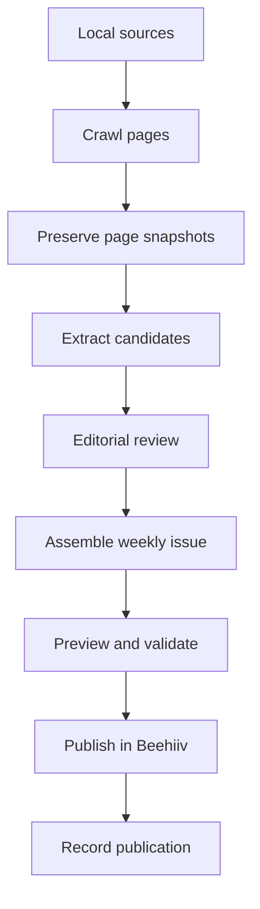
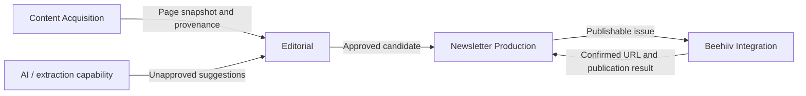
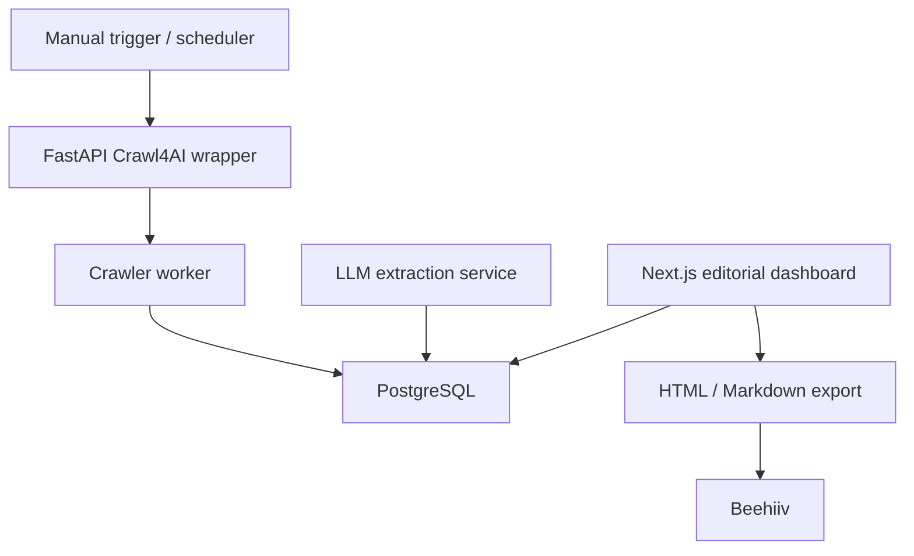

# Along the Lake

## Product, Domain-Driven Design Learning, Delivery, and Jira Plan

**Document status:** Working project brief  
**Last updated:** September 29, 2026  
**Primary repository:** https://github.com/goncalomiranda/home-dashboard  
**Newsletter:** https://alongthelake.beehiiv.com/  
**Current repository baseline:** commit `1ce898c814322c082613ba4873270ebadf59e532`  
**Owner/editor/developer:** Gonçalo Miranda

---

## 1. Start here

This document is the single project brief for **Along the Lake**. It connects three goals:

1. Build a useful weekly local newsletter.
2. Learn Domain-Driven Design by applying it to real software.
3. Publish a blog series that explains the decisions and lessons from the implementation.

The product goal is the priority. DDD and the blog support the product; they must not delay the first published issue.

### The only active product goal

> Produce a weekly guide to events, food, and hidden gems in Clarkson, Lorne Park, Port Credit, and Lakeview.

The first milestone is deliberately narrower:

> Use the existing crawled content and event data to review candidates, assemble one weekly issue, preview it, manually transfer it to Beehiiv, and record that it was published.

### Explicitly out of scope

The following ideas do not belong in the current project:

- General home-management features
- Car invoice management
- Personal-document generation
- GitHub/Jekyll blog publishing automation
- Dune-themed fictional domains
- A generic AI-agent platform
- Subscriber management
- Newsletter personalization
- Monetization and advertising
- A mobile application
- Microservice decomposition for its own sake
- Kafka, event sourcing, Neo4j, or full GraphRAG in the first milestone
- Automated Beehiiv publishing in the first milestone

If one of these ideas returns, record it outside the active backlog. Do not create implementation tickets for it while Milestone 1 is incomplete.

---

## 2. Product vision

### Vision statement

Along the Lake helps residents discover worthwhile things to do, eat, and explore close to home without searching across dozens of municipal, venue, restaurant, community, and social-media sources.

### Geographic coverage

- Clarkson
- Lorne Park
- Port Credit
- Lakeview

### Editorial categories

- Events
- Food
- Hidden gems
- Local news may be added later when it directly supports the guide.

### Primary users

**The editor**

Gonçalo reviews discovered information, corrects extracted details, approves or rejects candidates, assembles the weekly issue, previews it, and publishes it.

**The reader**

A resident or visitor wants a concise, trustworthy guide to what is happening nearby.

### Desired outcome

The software should reduce the repetitive work required to create a good issue while keeping editorial judgment with the editor.

The system is not intended to autonomously publish everything an AI model finds.

---

## 3. Current state

### Existing home-dashboard application

The repository currently contains:

- Next.js 16.3.6 with the App Router
- React 19.3 and TypeScript
- PostgreSQL access through `pg`
- A Material Dashboard-based administrative interface
- `/admin/newsletter` for crawled content, crawl jobs, AI summaries, and events
- API routes for crawled content, crawl jobs, event CRUD, and AI summaries
- `public.crawled_content`
- `core.crawl_jobs`
- An externally created `core.event` table used by the application
- Filtering events by a date range
- A “next weekend” filter

The main relevant files are:

```text
src/app/admin/newsletter/page.tsx
src/app/api/newsletter/route.ts
src/app/api/crawl-jobs/route.ts
src/app/api/events/route.ts
src/app/api/events/[id]/route.ts
src/app/api/ai-summary/route.ts
src/lib/db.ts
src/types/newsletter.ts
setup-database.sql
```

### Existing acquisition service

A separate FastAPI service wraps Crawl4AI and:

- Accepts a list of URLs.
- Creates a crawl-job record.
- Launches `newsletter_crawl.py` as a subprocess.
- Performs a best-first deep crawl.
- Stores URL, title, and Markdown in PostgreSQL.
- Updates job status through `STARTING`, `RUNNING`, `DONE`, or `FAILED`.
- Provides a generic `/openclaw-fetch` endpoint.

### Existing infrastructure

- Crawl4AI runs on the Raspberry Pi.
- PostgreSQL stores newsletter information.
- LLM extraction should remain outside Crawl4AI.
- Beehiiv already hosts the Along the Lake newsletter shell.
- SearXNG can later support source discovery.
- Temporal is available in the home lab, but adopting it is not a prerequisite for Milestone 1.

### Current gaps

The existing solution can fetch and display content, but it does not yet provide a complete editorial workflow:

- Crawled pages are not modeled as editorial candidates.
- There is no approval/rejection queue.
- There is no newsletter issue model.
- Approved items cannot be arranged into sections.
- There is no issue preview or export.
- Publication in Beehiiv is not recorded.
- Page content is overwritten by URL instead of preserving fetch history.
- The existing event model has no provenance back to a crawled page.
- Business rules live mostly in API routes and UI code.

### Immediate security and reliability concerns

- Rotate any real database credentials that were previously pasted into chat or committed elsewhere.
- Load database credentials from environment variables.
- Do not interpolate request data into `/bin/bash -c`; invoke the virtual-environment Python executable directly.
- A crawl containing partial failures must not be reported as fully successful.
- The worker should not keep a shared database cursor open for the entire crawl.
- API errors should return meaningful HTTP status codes.
- The newsletter should display and calculate local dates with `America/Toronto`.

---

## 4. End-to-end workflow



### Milestone 1 happy path

1. The editor views content that has already been crawled.
2. The editor creates or reviews a candidate from that content.
3. The candidate contains a title, description, source, category, neighbourhood, and relevant dates.
4. The editor approves the candidate.
5. The editor creates a weekly issue.
6. The editor adds approved candidates to Events, Food, or Hidden Gems.
7. The editor orders the items.
8. The system generates an HTML or Markdown preview.
9. The editor manually copies the issue to Beehiiv and publishes it.
10. The editor records the Beehiiv URL and publication time.

This proves the product before source discovery, extraction, and publishing are heavily automated.

---

## 5. Strategic Domain-Driven Design

### Business domain

The business domain is **local media and community information**, delivered
through local newsletter publishing.

### Subdomains

| Subdomain | Purpose | Classification for this product |
|---|---|---|
| Local discovery and editorial curation | Decide what is relevant, trustworthy, and worth recommending | Core |
| Content acquisition | Fetch and preserve material from local sources | Supporting |
| Candidate extraction | Turn acquired material into structured possibilities for review | Supporting capability within Editorial |
| Newsletter production | Assemble approved candidates into a coherent weekly issue | Supporting for now; see the open question in the canonical domain-language document |
| Beehiiv publishing | Deliver the finished issue through an external platform | Generic integration |
| AI assistance | Suggest extracted details or summaries without making editorial decisions | Generic/supporting capability |

The core domain is local discovery and editorial judgment, not web crawling or newsletter delivery. The detailed definitions, context boundaries, workflow evidence, and unresolved classification question are maintained in the canonical [domain-language and context-map document](./newsletter-domain-language.md).

### Bounded contexts

The target model has four contexts: Content Acquisition, Editorial, Newsletter
Production, and Beehiiv Integration. Their responsibilities, explicit
exclusions, current-state evidence, and handoff contracts are defined in the
canonical [domain-language and context-map document](./newsletter-domain-language.md).

### Context map



The arrows represent information handoffs, not automated integrations. Beehiiv
publication is manual for Milestone 1. Editorial and Newsletter Production
may remain modules in one Next.js application; bounded contexts do not require
separate deployments.

---

## 6. Ubiquitous language

The canonical glossary, context-scoped definitions, and terms to avoid are
maintained in [Domain Language and Context Map](./newsletter-domain-language.md).
Use that glossary consistently in conversation, code, database names, APIs,
Jira, and project documentation. Keep this brief focused on the tactical model
and delivery plan rather than maintaining a second glossary.

---

## 7. Tactical domain model

### Value objects

#### Neighbourhood

```text
CLARKSON
LORNE_PARK
PORT_CREDIT
LAKEVIEW
```

One candidate may be relevant to more than one neighbourhood.

#### Editorial category

```text
EVENT
FOOD
HIDDEN_GEM
```

#### Publication window

A date range used to select relevant events for an issue. It is evaluated after extraction, not during crawling.

#### Source reference

Contains the source URL, page-snapshot identity, and fetch time needed to explain where a candidate came from.

### Candidate entity

```text
EditorialCandidate
├── candidateId
├── candidateType
├── headline
├── summary
├── neighbourhoods[]
├── sourceReference
├── status
├── discoveredAt
├── reviewedAt
└── category-specific details
```

Candidate lifecycle:

```text
DISCOVERED → NEEDS_REVIEW → APPROVED
                          └→ REJECTED
```

Initial domain behaviour:

```text
candidate.submitForReview()
candidate.correctDetails(...)
candidate.approve()
candidate.reject(reason)
```

Candidate invariants:

- Every candidate must retain provenance.
- An approved candidate must have a headline, summary, category, and at least one neighbourhood.
- An event candidate must have a start date.
- A rejected candidate cannot be added to an issue.
- An editorial decision records when it occurred.

### NewsletterIssue aggregate

```text
NewsletterIssue
├── issueId
├── title
├── publicationDate
├── publicationWindow
├── status
├── sections[]
│   └── issueItems[]
└── publication
```

Issue lifecycle:

```text
DRAFT → READY → PUBLISHING → PUBLISHED
                     └─────→ FAILED
DRAFT → CANCELLED
```

Initial domain behaviour:

```text
issue.addCandidate(candidate, section)
issue.removeItem(issueItemId)
issue.moveItem(issueItemId, newPosition)
issue.editItem(issueItemId, headline, summary)
issue.markReady()
issue.returnToDraft()
issue.markPublished(publicationReference)
```

Issue invariants:

- Only approved candidates may be added.
- The same candidate cannot appear twice in one issue.
- An issue must contain at least one item before becoming ready.
- A published issue is immutable.
- An issue cannot be published twice.
- Section positions must be unique and continuous.
- The issue item preserves its published headline and summary even if the original candidate later changes.

### Domain events

Use domain events first as in-process records or application notifications. A message broker is unnecessary in Milestone 1.

```text
CandidateDiscovered
CandidateSubmittedForReview
CandidateApproved
CandidateRejected
NewsletterIssueCreated
CandidateAddedToIssue
IssueItemReordered
NewsletterIssueMarkedReady
NewsletterIssuePublished
```

Because “local event” and “domain event” are easy to confuse, code may use names such as `CandidateApprovedDomainEvent` when necessary.

---

## 8. Modeling time

Time is a business concern for a weekly events newsletter.

### Rules already accepted

- Store all upcoming events after extraction.
- Do not restrict crawling to the next newsletter window.
- Filter events when querying or building an issue.
- Retain future events and approximately seven days of recent event history.
- A multi-day event overlaps a newsletter window when:

```text
event.start <= window.end
AND
event.end >= window.start
```

If `event.end` is missing, treat the event as ending at an appropriate time on its start date according to the domain policy.

### Technical policy

- Persist timestamps with timezone awareness.
- Use UTC for storage when practical.
- Display and calculate editorial dates using `America/Toronto`.
- Distinguish the event’s start/end time from `discoveredAt`, `fetchedAt`, `reviewedAt`, and `publishedAt`.

### Current query defect to correct

The current event filter is not a complete interval-overlap query. The implementation should be replaced with the accepted overlap rule so multi-day events are included correctly.

---

## 9. Target architecture

### Deployment view



### Architecture decisions

- Keep Crawl4AI focused on fetching and cleaning pages.
- Keep LLM extraction outside Crawl4AI.
- Keep Next.js as the editorial and production application.
- Keep PostgreSQL as the system of record.
- Use a modular monolith inside the Next.js application.
- Keep the crawler as a separate technical service because it already exists and has different runtime dependencies.
- Use manual Beehiiv publication for Milestone 1.
- Delay orchestration migration decisions until the product workflow works end to end.

### Suggested Next.js organization

Introduce this structure incrementally. Do not move all existing files in one refactor.

```text
src/
├── app/
│   ├── admin/newsletter/
│   └── api/
├── modules/
│   ├── editorial/
│   │   ├── domain/
│   │   ├── application/
│   │   └── infrastructure/
│   ├── newsletter-production/
│   │   ├── domain/
│   │   ├── application/
│   │   └── infrastructure/
│   └── acquisition/
│       └── infrastructure/
├── components/
└── shared/
```

Dependency direction:

```text
Next.js route/UI
    ↓
Application use case
    ↓
Domain model
    ↓ through an interface
Repository implementation / PostgreSQL
```

The domain model should not import Next.js, React, `pg`, Crawl4AI, or Beehiiv SDKs.

### Initial application use cases

```text
ListCandidatesForReview
CreateCandidateFromCrawledContent
CorrectCandidateDetails
SubmitCandidateForReview
ApproveCandidate
RejectCandidate
CreateNewsletterIssue
AddCandidateToIssue
RemoveIssueItem
ReorderIssueItems
MarkIssueReady
GenerateIssuePreview
RecordManualPublication
```

---

## 10. Data model and migration direction

Do not delete current tables to start over. Make additive changes and migrate safely.

### Proposed schemas

```text
acquisition
├── sources
├── crawl_runs
├── crawled_pages
└── page_snapshots

editorial
├── candidates
├── candidate_neighbourhoods
├── event_details
└── editorial_decisions

newsletter
├── issues
├── issue_sections
├── issue_items
└── publications
```

### Migration mapping

| Existing structure | Direction |
|---|---|
| `core.crawl_jobs` | Evolve or migrate to `acquisition.crawl_runs` |
| `public.crawled_content` | Treat as current raw input; later split page identity from snapshots |
| `core.event` | Use as migration input for event candidates; do not silently reinterpret existing data |

### Snapshot policy

The current crawler updates a row when the URL already exists. The target design separates:

- A stable page identity identified by canonical URL.
- An append-only snapshot with fetched content and timestamp.
- A content hash used to avoid storing unchanged snapshots.

This makes changes traceable and prevents historical evidence from being overwritten.

### Minimal Milestone 1 tables

To avoid a large data migration before product value, Milestone 1 only requires:

```text
editorial.candidates
editorial.candidate_neighbourhoods
newsletter.issues
newsletter.issue_items
newsletter.publications
```

Candidates may initially reference `public.crawled_content.id`. The acquisition redesign can follow once the editorial workflow is usable.

---

## 11. API direction

The following routes describe intent. Exact REST naming may evolve.

```text
GET    /api/editorial/candidates
POST   /api/editorial/candidates
GET    /api/editorial/candidates/{id}
PUT    /api/editorial/candidates/{id}
POST   /api/editorial/candidates/{id}/submit
POST   /api/editorial/candidates/{id}/approve
POST   /api/editorial/candidates/{id}/reject

GET    /api/newsletter/issues
POST   /api/newsletter/issues
GET    /api/newsletter/issues/{id}
POST   /api/newsletter/issues/{id}/items
PUT    /api/newsletter/issues/{id}/items/{itemId}
DELETE /api/newsletter/issues/{id}/items/{itemId}
POST   /api/newsletter/issues/{id}/ready
GET    /api/newsletter/issues/{id}/preview
POST   /api/newsletter/issues/{id}/record-publication
```

API routes validate HTTP requests and invoke application use cases. They should not contain the main business rules or inline all persistence logic.

---

## 12. AI and extraction policy

AI proposes; the editor decides.

### Suitable AI responsibilities

- Extract event details from a page snapshot.
- Suggest candidate category and neighbourhood.
- Draft a concise summary.
- Detect likely duplicates.
- Suggest tags or issue sections.

### Responsibilities that remain deterministic or human-controlled

- Whether a candidate is approved.
- Whether a source is trusted.
- Which issue includes a candidate.
- Final wording and ordering.
- Whether the issue is published.

### Provenance requirement

Every AI-generated candidate must retain:

- Source URL
- Page-snapshot identity or current crawled-content identity
- Fetch time
- Extraction time
- Extractor/model identifier when available

### GraphRAG position

GraphRAG is a possible later learning exercise, not an MVP dependency.

An eventual small knowledge model could connect:

```text
Event → occursAt → Venue
Event → relevantTo → Neighbourhood
Venue → locatedIn → Neighbourhood
Candidate → derivedFrom → PageSnapshot
```

Do not add Neo4j initially. PostgreSQL relations and, later, `pgvector` are sufficient to validate useful queries.

---

## 13. Delivery roadmap

### Milestone 0 — Recover and baseline

Outcome: the existing application and crawler can be run safely and their current behavior is understood.

- Confirm local and home-lab startup instructions.
- Confirm database tables and create a non-destructive backup.
- Rotate exposed credentials and use environment variables.
- Remove shell interpolation from crawler process launch.
- Establish the current build/lint baseline.
- Record existing workflow and known defects.

### Milestone 1 — Publish one issue manually

Outcome: one complete issue is produced through the dashboard and published in Beehiiv.

- Create the Candidate model and schema.
- Convert existing crawled content or events into candidates.
- Build the candidate review queue.
- Approve and reject candidates.
- Create the NewsletterIssue aggregate and persistence.
- Build an issue editor with sections and ordering.
- Generate HTML or Markdown preview.
- Copy the issue manually to Beehiiv.
- Record the publication URL and timestamp.

This is the active milestone.

### Milestone 2 — Improve acquisition reliability

Outcome: crawling is observable, secure, and preserves history.

- Introduce sources and crawl-run semantics.
- Preserve page snapshots.
- Support completed-with-errors results.
- Track per-URL failures.
- Add content hashes and canonical URLs.
- Make crawls safely repeatable.

### Milestone 3 — Add assisted extraction and discovery

Outcome: the system reliably suggests structured candidates from a small source set.

- Start with 5–10 trusted sources.
- Extract events, venues, neighbourhoods, dates, and summaries.
- Add duplicate suggestions.
- Add SearXNG discovery with cached results.
- Run discovery daily or every two to three days.
- Treat Facebook as a discovery hint; prefer official venue, municipal, or Eventbrite pages as evidence.

### Milestone 4 — Improve issue production

Outcome: creating the weekly issue is quick and repeatable.

- Reusable issue template.
- Editorial validation warnings.
- Better section management.
- Image handling.
- Issue archive.
- Publication analytics if they become useful.

### Milestone 5 — Automate Beehiiv publishing

Outcome: approved issues can be sent to Beehiiv through a reliable adapter.

- Confirm Beehiiv API capabilities for the selected plan.
- Create draft in Beehiiv.
- Record external ID.
- Handle failed or duplicate requests.
- Require explicit human confirmation before publication.

---

## 14. Jira hierarchy

Create the following roadmap epics. Only decompose and activate the stories under **Epic 1** and **Epic 2** initially. The remaining epics should exist as roadmap containers until Milestone 1 is nearly complete.

### Epic 1 — ATL Foundation and Recovery

**Goal:** Establish a safe, reproducible baseline without redesigning the system.

#### ATL-F01 — Document the existing runtime and data flow

**Type:** Story  
**Priority:** Highest  
**Size:** S

**Description**

Document how the Next.js dashboard, FastAPI wrapper, crawler worker, PostgreSQL, LLM endpoint, and Beehiiv currently interact.

**Acceptance criteria**

- Startup commands and service locations are recorded.
- Current database tables and ownership are recorded.
- Current API endpoints are listed.
- The current manual steps from crawl to Beehiiv are recorded.
- Unknowns are listed explicitly rather than guessed.

#### ATL-F02 — Secure crawler configuration

**Type:** Story  
**Priority:** Highest  
**Size:** S

**Description**

Remove hardcoded database credentials from the FastAPI service and crawler worker.

**Acceptance criteria**

- Real credentials previously exposed are rotated.
- Both processes read configuration from environment variables.
- An example environment file contains placeholders only.
- No secrets appear in source control or logs.
- Missing configuration causes a clear startup failure.

#### ATL-F03 — Remove unsafe shell invocation

**Type:** Story  
**Priority:** Highest  
**Size:** S

**Description**

Launch the crawler using the virtual environment’s Python executable without `/bin/bash -c` or string interpolation.

**Acceptance criteria**

- Request values are passed as separate process arguments.
- No `source` command is required.
- URLs containing spaces or shell metacharacters cannot alter the executed command.
- The API still returns a job ID immediately.

#### ATL-F04 — Establish repository quality baseline

**Type:** Task  
**Priority:** High  
**Size:** S

**Acceptance criteria**

- Dependencies install from the lockfile.
- Current lint result is recorded.
- Current production-build result is recorded.
- Next.js and `eslint-config-next` versions are reviewed for alignment.
- Existing failures are captured as separate tickets rather than hidden.

#### ATL-F05 — Create database backup and migration procedure

**Type:** Task  
**Priority:** High  
**Size:** S

**Acceptance criteria**

- A backup can be created before schema changes.
- A restore command is documented and tested against a non-production database when practical.
- Database migrations are versioned in source control.
- Migrations do not drop current newsletter data in Milestone 1.

### Epic 2 — ATL First Publishable Issue

**Goal:** Produce one complete weekly issue through the dashboard and publish it manually to Beehiiv.

#### ATL-M101 — Record the ubiquitous language and first context map

**Type:** Story  
**Priority:** Highest  
**Size:** S

**Acceptance criteria**

- The canonical glossary in `docs/newsletter-domain-language.md` is reviewed and adjusted against the real workflow.
- Content Acquisition, Editorial, Newsletter Production, and Beehiiv Integration are documented.
- Each context has explicit responsibilities and exclusions.
- Important disagreements or unanswered questions are recorded.

#### ATL-M102 — Add editorial candidate schema

**Type:** Story  
**Priority:** Highest  
**Size:** M  
**Depends on:** ATL-F05, ATL-M101

**Acceptance criteria**

- Candidate records support type, headline, summary, category, status, provenance, and timestamps.
- Candidates support one or more of the four neighbourhoods.
- Event candidates support start date, optional end date, venue, and location.
- Status values are constrained.
- The migration is additive and does not destroy current data.

#### ATL-M103 — Implement Candidate domain model

**Type:** Story  
**Priority:** Highest  
**Size:** M  
**Depends on:** ATL-M101

**Acceptance criteria**

- Domain code does not import Next.js or PostgreSQL libraries.
- Candidate approval enforces required headline, summary, category, provenance, and neighbourhood.
- Event candidates require a start date before approval.
- Rejection records a reason.
- Unit tests cover valid and invalid transitions.

#### ATL-M104 — Create candidate from existing crawled content

**Type:** Story  
**Priority:** Highest  
**Size:** M  
**Depends on:** ATL-M102, ATL-M103

**Acceptance criteria**

- The editor can select an existing crawled-content record.
- A candidate form is pre-populated with available title, source URL, and content.
- The editor can complete or correct all candidate fields.
- The candidate retains the crawled-content record as provenance.
- Creation does not require automated AI extraction.

#### ATL-M105 — Build editorial review queue

**Type:** Story  
**Priority:** Highest  
**Size:** M  
**Depends on:** ATL-M102, ATL-M103

**Acceptance criteria**

- Candidates can be filtered by status, category, and neighbourhood.
- The source page is accessible during review.
- The editor can correct candidate details.
- The editor can approve or reject a candidate.
- The UI shows validation errors returned by the domain/application layer.

#### ATL-M106 — Correct publication-window event filtering

**Type:** Story  
**Priority:** High  
**Size:** S

**Acceptance criteria**

- Filtering uses interval overlap rather than requiring the entire event inside the window.
- Multi-day events spanning a weekend are included.
- Single-day events are handled consistently.
- Tests cover events before, after, inside, and spanning the window.
- Date display uses `America/Toronto`.

#### ATL-M107 — Add newsletter issue schema

**Type:** Story  
**Priority:** Highest  
**Size:** M  
**Depends on:** ATL-F05, ATL-M101

**Acceptance criteria**

- Issues have title, publication date, window, status, and timestamps.
- Issue items reference an approved candidate.
- Issue items preserve edited headline and summary snapshots.
- Items support section and position.
- Publication records support Beehiiv URL, external ID when available, and publication time.

#### ATL-M108 — Implement NewsletterIssue aggregate

**Type:** Story  
**Priority:** Highest  
**Size:** M  
**Depends on:** ATL-M101

**Acceptance criteria**

- Only approved candidates can be added.
- A candidate cannot appear twice in one issue.
- Items can be removed and reordered while the issue is a draft.
- An empty issue cannot become ready.
- Published issues cannot be modified.
- Unit tests cover lifecycle and invariants.

#### ATL-M109 — Build weekly issue editor

**Type:** Story  
**Priority:** Highest  
**Size:** L  
**Depends on:** ATL-M105, ATL-M107, ATL-M108

**Acceptance criteria**

- The editor can create a draft issue.
- Approved candidates can be added to Events, Food, or Hidden Gems.
- The editor can edit issue-specific headline and summary.
- Items can be removed and reordered.
- Issue state and validation problems are visible.

#### ATL-M110 — Generate issue preview and export

**Type:** Story  
**Priority:** Highest  
**Size:** M  
**Depends on:** ATL-M109

**Acceptance criteria**

- The issue can be previewed as readers will see it.
- A deterministic Markdown or HTML representation can be copied or downloaded.
- Preview output contains sections and source links.
- The preview does not mark the issue as published.

#### ATL-M111 — Record manual Beehiiv publication

**Type:** Story  
**Priority:** Highest  
**Size:** S  
**Depends on:** ATL-M110

**Acceptance criteria**

- The editor can record the Beehiiv URL after manual publication.
- Publication time is recorded.
- The issue transitions to `PUBLISHED` once.
- Published issues become read-only.
- The dashboard links to the Beehiiv publication.

#### ATL-M112 — Publish the first complete Along the Lake issue

**Type:** Milestone/Story  
**Priority:** Highest  
**Size:** M  
**Depends on:** ATL-M104 through ATL-M111

**Acceptance criteria**

- The issue contains reviewed material relevant to the covered neighbourhoods.
- Each item has valid provenance.
- The issue is previewed through the dashboard.
- The issue is published in Beehiiv.
- Publication is recorded in the dashboard.
- Problems and manual work discovered during the process are captured for prioritization.

### Epic 3 — ATL Acquisition Reliability

**Goal:** Make crawling safe, traceable, and repeatable.

Roadmap stories:

- Model and manage trusted sources.
- Replace `crawl_jobs` with explicit crawl-run semantics.
- Track per-URL outcomes and partial success.
- Separate stable page identity from append-only snapshots.
- Add canonical URL handling and content hashes.
- Add retry policy and idempotent execution.
- Improve logs and operational visibility.
- Separate the generic OpenClaw fetch endpoint from newsletter acquisition.

### Epic 4 — ATL Assisted Extraction and Discovery

**Goal:** Suggest useful candidates from a small trusted source set.

Roadmap stories:

- Define structured extraction contract.
- Extract event, venue, date, neighbourhood, category, summary, and provenance.
- Add human review of every extracted candidate.
- Add duplicate suggestions.
- Configure 5–10 trusted sources.
- Introduce SearXNG-assisted discovery.
- Schedule discovery every one to three days.
- Measure extraction quality and correction frequency.

### Epic 5 — ATL Newsletter Production Improvements

**Goal:** Make weekly issue creation faster and more consistent.

Roadmap stories:

- Create reusable issue template.
- Add editorial completeness checks.
- Add archive and issue history.
- Add image selection and attribution.
- Add issue-level editorial notes.
- Add content reuse warnings.

### Epic 6 — ATL Beehiiv Integration

**Goal:** Publish a finished issue through a reliable adapter.

Roadmap stories:

- Research Beehiiv API access for the current plan.
- Map the internal issue format to Beehiiv.
- Create a Beehiiv draft.
- Store external IDs and URLs.
- Add idempotency and failure handling.
- Require explicit approval before publication.

### Epic 7 — ATL DDD Learning and Blog Series

**Goal:** Turn real product decisions into a coherent DDD learning journey.

#### ATL-B01 — Blog Part 1: Discovering the Along the Lake domain

Cover:

- Why the project stalled
- Business problem and product vision
- EventStorming of the editorial workflow
- Ubiquitous language
- Core, supporting, and generic subdomains

**Publish after:** ATL-M101

#### ATL-B02 — Blog Part 2: Finding bounded contexts in a newsletter system

Cover:

- Content Acquisition
- Editorial
- Newsletter Production
- Beehiiv Integration
- Context map
- Why bounded contexts are not automatically microservices

**Publish after:** ATL-M104

#### ATL-B03 — Blog Part 3: From CRUD records to a domain model

Cover:

- Candidate entity
- Value objects
- NewsletterIssue aggregate
- Invariants
- Domain services versus application services
- What remains simple transaction-script logic

**Publish after:** ATL-M108

#### ATL-B04 — Blog Part 4: Modeling time for a local-events newsletter

Cover:

- Event time versus fetch/review/publication time
- Publication windows
- Multi-day overlap
- Time zones
- Historical snapshots and provenance

**Publish after:** ATL-M106

#### ATL-B05 — Blog Part 5: Architecture and communication patterns

Cover:

- Modular monolith
- Ports and adapters
- Separate crawler runtime
- Synchronous API and asynchronous jobs
- Idempotency and partial failure
- When Temporal may or may not help

**Publish after:** Milestone 2

#### ATL-B06 — Blog Part 6: Evolving the design

Cover:

- Manual extraction to AI assistance
- Manual Beehiiv publishing to an adapter
- Schema evolution
- Microservice boundaries
- Event-driven architecture
- GraphRAG and analytical data products as optional later capabilities

**Publish after:** At least one real production cycle and subsequent design change

### Blog rule

Do not wait for a polished article before implementing. Keep short decision notes during development, then write each article after the relevant software milestone provides evidence.

---

## 15. DDD learning coverage

This matrix keeps the learning goal connected to concrete product work.

| DDD topic | Along the Lake exercise | Evidence or blog output |
|---|---|---|
| Analyzing business domains | Classify editorial curation, acquisition, production, and publishing | ATL-B01 |
| Discovering domain knowledge | EventStorming, workflow interviews with yourself as editor, and glossary refinement | ATL-M101, ATL-B01 |
| Managing domain complexity | Separate acquisition facts, editorial decisions, and issue composition | ATL-B02 |
| Integrating bounded contexts | Define page snapshot, approved candidate, and publishable issue contracts | ATL-B02 |
| Implementing simple business logic | Date overlap, neighbourhood and category value objects, validation functions | ATL-M106, ATL-B03/B04 |
| Tackling complex business logic | Candidate lifecycle and NewsletterIssue invariants | ATL-M103, ATL-M108, ATL-B03 |
| Modeling time | Event windows, multi-day overlap, fetch/review/publication timestamps | ATL-M106, ATL-B04 |
| Architectural patterns | Modular monolith, ports and adapters, separate crawler runtime | ATL-B05 |
| Communication patterns | Crawl jobs, LLM extraction, idempotency, partial failures, later Beehiiv adapter | Milestone 2, ATL-B05 |
| Design heuristics | Small aggregates, manual-first integration, provenance, incremental migration | Decision log and retrospectives |
| Evolving design decisions | Manual candidate creation to AI assistance; manual Beehiiv to API adapter | ATL-B06 |
| EventStorming | Map discovery through publication and identify commands, policies, and hot spots | ATL-M101, ATL-B01 |
| DDD in the real world | Security, migrations, observability, testing, and imperfect legacy tables | Epics 1–3 |
| Microservices | Evaluate crawler boundary and resist service-per-context decomposition | ATL-B05/B06 |
| Event-driven architecture | Use domain events in-process first; introduce asynchronous integration only with evidence | ATL-B05/B06 |
| Data mesh | Consider domain-owned analytical products only after publication data exists | ATL-B06 |

---

## 16. Testing strategy

### Domain tests

- Candidate transition tests
- Candidate approval invariant tests
- NewsletterIssue lifecycle tests
- Duplicate issue-item tests
- Published-issue immutability tests
- Publication-window overlap tests

### Application tests

- Use case loads and saves through repository ports.
- Invalid transitions are returned as understandable errors.
- Manual publication is idempotent.

### Integration tests

- PostgreSQL migrations apply to an empty database.
- Migrations preserve existing data.
- Repository implementations enforce constraints.
- API routes return expected status codes.

### End-to-end test

The critical scenario is:

```text
Crawled page
→ candidate created
→ candidate approved
→ issue created
→ candidate added
→ preview generated
→ manual publication recorded
```

---

## 17. Definition of Done

A Jira story is complete when:

- Acceptance criteria are satisfied.
- Relevant domain and application tests pass.
- Database changes are versioned and non-destructive.
- Error behavior is explicit.
- No credentials or personal secrets are committed.
- Naming follows the ubiquitous language.
- The repository README or project documentation is updated when operational behavior changes.
- The story can be demonstrated through the UI or a documented API call.
- Follow-up ideas are captured separately and do not silently expand the story.

Milestone 1 is complete only when a real issue is published in Beehiiv and recorded in the application.

---

## 18. Architecture decision log

### Accepted decisions

| Decision | Rationale |
|---|---|
| Focus only on Along the Lake | Prevent the dashboard from becoming an unbounded multipurpose project |
| Keep Crawl4AI fetch-only | Separate acquisition mechanics from editorial interpretation |
| Keep LLM processing outside Crawl4AI | Models and prompts can evolve independently from crawling |
| Use PostgreSQL as system of record | Existing infrastructure and sufficient modeling capability |
| Start with a modular monolith | Preserve boundaries without distributed-system overhead |
| Keep crawler as a separate service | Existing runtime and browser dependencies justify the technical boundary |
| Store upcoming events and filter later | One crawl can support multiple future issue windows |
| Preserve provenance | Editorial trust and correction require traceability |
| Human approval before publication | Editorial judgment is part of the core domain |
| Manual Beehiiv publishing in Milestone 1 | Validate the workflow before automating the final adapter |
| Delay GraphRAG | It should solve demonstrated retrieval problems, not define the MVP |

### Decisions still open

- Final Jira project key and issue-type configuration
- Whether candidate is the permanent aggregate root or an application-stage entity
- Whether Food and Hidden Gems need distinct detail models after real examples are collected
- Which 5–10 sources form the first trusted source set
- Exact issue publication day and editorial window
- Whether the current `core.event` data should be migrated or wrapped temporarily
- Which orchestration mechanism will replace manual scheduling after Milestone 1
- Beehiiv API availability and limits for the current plan

Open decisions should become time-boxed spikes only when they block the active milestone.

---

## 19. Anti-procrastination operating rules

1. Keep only one milestone active: publish the first issue.
2. Keep no more than three Jira stories in progress.
3. Prefer a working vertical slice over a complete architectural refactor.
4. Time-box research that blocks a story.
5. Add new ideas to the roadmap; do not insert them into the active sprint.
6. End each work session by recording the next physical action.
7. Write blog notes after coding sessions; polish the post after the milestone.
8. A manual step is acceptable until it becomes the demonstrated bottleneck.
9. DDD vocabulary must clarify the workflow, not add ceremony.
10. The weekly newsletter—not the architecture—is the measure of progress.

### Recommended active queue

Begin with only these tickets:

1. ATL-F01 — Document existing runtime and data flow
2. ATL-F02 — Secure crawler configuration
3. ATL-F03 — Remove unsafe shell invocation
4. ATL-F05 — Create database backup and migration procedure
5. ATL-M101 — Record ubiquitous language and context map
6. ATL-M102 — Add editorial candidate schema

After those are complete, pull ATL-M103 and ATL-M104.

---
