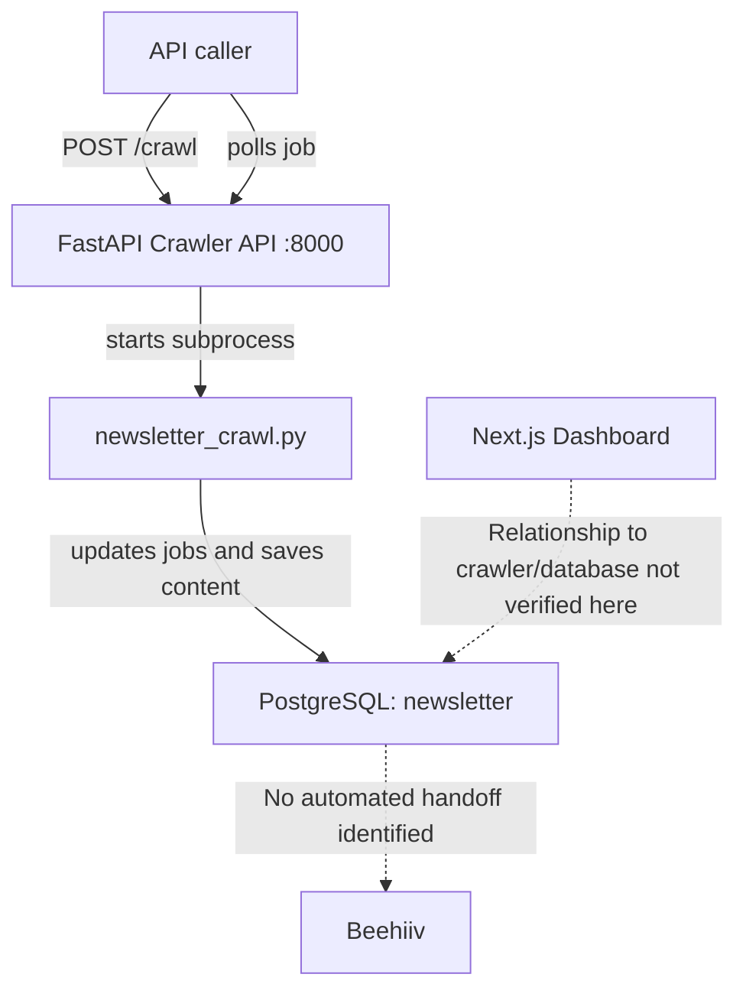

# Current System

## Purpose

Document the current system as it exists before the DDD refactoring. Crawl4AI
service details below were checked against the service files and running HTTP
API on 2026-10-07; runtime facts may change.

## System Inventory

| System | Responsibility | Location | Port | Data Owned |
|---|---|---|---|---|
| Home Dashboard | Newsletter administration UI | Host running the Next.js project; `npm run dev` is used for local development | 3000 | None established here |
| Crawler API | Starts and monitors crawl jobs | `/home/gmiranda/crawl4ai-service`; systemd service `crawler-api.service`, running as `gmiranda` | 8000 | Creates and reads crawl-job records |
| Crawl4AI Worker | Fetches webpages and saves crawl results | `/home/gmiranda/crawl4ai-service/newsletter_crawl.py`, launched as a subprocess by the API | N/A | Writes crawled content |
| PostgreSQL | Stores newsletter and crawl data | `localhost` on the crawler host | 5432 | Database `newsletter`; full schema inventory unverified |
| LLM Processor | Extracts and summarizes information | TBD | TBD | None |
| Beehiiv | External newsletter publishing platform | External | HTTPS | Published issues; integration from this service not present |

## Current System Flow



## Components

### Home Dashboard

- Repository: `https://github.com/goncalomiranda/home-dashboard`
- Runtime: Next.js
- Development: `npm run dev` on the `popos` host (manually started)
- Responsibility:
  - Display crawled content
  - Display crawl jobs
  - Manage extracted events
  - Generate AI summaries

#### How to use it

- npm run dev
- Host: `popos`; manually started

### Crawler API

- Runtime: FastAPI
- Service directory: `/home/gmiranda/crawl4ai-service`
- Installed systemd unit: `/etc/systemd/system/crawler-api.service`
- Unit source: `crawler-api.service` in the service directory
- Runs as: `gmiranda`, with working directory `/home/gmiranda/crawl4ai-service`
- Command: `/home/gmiranda/crawl4ai-env/bin/uvicorn crawler_api:app --host 0.0.0.0 --port 8000`
- Virtual environment: `/home/gmiranda/crawl4ai-env` (Python 3.11.8)
- Runtime state when checked: active; listening on port 8000
- Responsibility:
  - Accept crawl requests
  - Create crawl jobs
  - Start the crawler worker
  - Return job status
- Application log: `/home/gmiranda/crawl4ai-service/logs/crawler_api.log`

### Crawl4AI Worker

- Runtime: Python and Crawl4AI
- Script: `/home/gmiranda/crawl4ai-service/newsletter_crawl.py`
- Execution: Started by the API in a subprocess for each crawl request
- Application log: `/home/gmiranda/crawl4ai-service/logs/newsletter_crawl.log`
- Responsibility:
  - Crawl submitted URLs
  - Convert pages to Markdown
  - Store results in PostgreSQL
- Crawl limits: depth 2 and at most 20 pages per starting URL

### PostgreSQL

- Host: `localhost` on the crawler host
- Port: `5432`
- Database: `newsletter`
- Application database user: `newsletter`
- Connection timezone configured by both API and worker: `America/New_York`
- Live table inventory and database object ownership have not been verified.

### LLM Processor

- Location: NVIDIA NIM API via Agentgateway (`pixel-worker-01`)
- Model: `nvidia/nemotron-3.5-lightning-30b-a3b`
- Responsibility:
  - Extract structured event information
  - Generate concise newsletter summaries
- Integration:
  - Application calls Agentgateway rather than NVIDIA directly
  - Agentgateway routes requests to NVIDIA's OpenAI-compatible API
  - NVIDIA API key is stored in Infisical and injected into Agentgateway at runtime
  - Model reasoning is disabled for summarization (`enable_thinking: false`)
- Current status:
  - Agentgateway → NVIDIA integration configured
  - Infisical secret injection configured
  - Nemotron model successfully tested through Agentgateway
  - Summary generation successfully validated
  - Application integration pending
  - Structured event extraction pending

#### Example request

```bash
curl -sS http://10.0.0.115:4000/v1/chat/completions \
  -H 'Content-Type: application/json' \
  -d '{
    "model": "nemotron-3.5-lightning-30b-a3b/nvidia/nemotron-3.5-lightning-30b-a3b",
    "messages": [
      {
        "role": "system",
        "content": "You are an editor for a local community newsletter. Write concise, factual summaries. Preserve important names, locations, dates and numbers. Do not add information that is not present in the source. Return only the summary, with no analysis or explanation."
      },
      {
        "role": "user",
        "content": "The City of Mississauga announced that a new community park will open in Port Credit next Saturday. The park includes a playground, walking paths, and a small outdoor performance area."
      }
    ],
    "temperature": 0.1,
    "max_tokens": 300,
    "chat_template_kwargs": {
      "enable_thinking": false
    }
  }' | jq
```

### Beehiiv

- Newsletter: `https://alongthelake.beehiiv.com/`
- Integration from the inspected crawler API and worker: Does not exist
- Responsibility:
  - Newsletter editing
  - Subscriber management
  - Publication and delivery
- Any manual handoff from saved crawl content to Beehiiv is unverified; see
  [Current Manual Steps](#current-manual-steps).

## Database Relations Referenced by Application Code

This is a code-derived list, not a complete or live-verified database
inventory. The application connects as `newsletter`; this does not establish
the ownership of either relation.

| Relation | Columns used by crawler code | Crawler code usage | Schema / ownership |
|---|---|---|---|
| `core.crawl_jobs` | `id`, `status`, `error`, `created_at`, `started_at`, `finished_at` | API inserts a `STARTING` job; worker updates status and timestamps; API reads job status | Schema is qualified; object owner not verified |
| `crawled_content` | `url`, `title`, `content`, `created_at`, and returned `id` | Worker inserts content, upserts on `url`, updates `created_at`, and returns the row ID | Unqualified schema resolution and object owner not verified |

The actual schema and existence of `public.crawled_content`, `core.event`, or
other relations have not been verified by a live PostgreSQL catalog query.
Do not treat this table as a complete database inventory.

## API Endpoints

The routes below are confirmed by the running API's OpenAPI document.

| Method | Endpoint | Purpose |
|---|---|---|
| `POST` | `/crawl` | Accepts `{"urls": ["https://..."]}`, creates a `STARTING` job, starts `newsletter_crawl.py` with the URLs and job ID, and returns `status`, `job_id`, and `urls` |
| `GET` | `/job/{job_id}` | Returns job status and timestamps, or an error if no matching job is found |
| `POST` | `/openclaw-fetch` | Accepts `{"url": "https://..."}` and crawls one URL, returning Markdown and title/source metadata or an error |

FastAPI's default documentation routes are enabled: `GET /openapi.json`,
`GET /docs`, `GET /docs/oauth2-redirect`, and `GET /redoc`. No application
health-check route was found in the inspected API.

### Home Dashboard

These dashboard routes are documented in this system inventory; they were not
part of the running crawler API verification above.

| Method | Endpoint | Purpose |
|---|---|---|
| `GET` | `/api/newsletter` | List crawled content |
| `GET` | `/api/crawl-jobs` | List crawl jobs |
| `GET` | `/api/events` | List events |
| `POST` | `/api/events` | Create an event |
| `PUT` | `/api/events/{id}` | Update an event |
| `DELETE` | `/api/events/{id}` | Delete an event |
| `POST` | `/api/ai-summary` | Generate a summary |

## How to Run

### Home Dashboard

```bash
npm install
npm run dev
```

### Crawler API

```bash
# Install the systemd unit from the service directory:
cd /home/gmiranda/crawl4ai-service
./service-manager.sh install

# Operate the installed service:
sudo systemctl start crawler-api
sudo systemctl status crawler-api
sudo systemctl restart crawler-api
sudo systemctl stop crawler-api

# Read logs using the service manager:
./service-manager.sh logs
./service-manager.sh logs-api
./service-manager.sh logs-newsletter
```

For development, run `./run-dev.sh` from `/home/gmiranda/crawl4ai-service`;
it starts the server with reload enabled on `0.0.0.0:8000`. The worker is
normally launched by the API as a subprocess.

## Current Manual Steps

### Confirmed Crawl Workflow

1. A caller submits URLs to `POST /crawl`.
2. The API creates a job with status `STARTING` and launches
   `newsletter_crawl.py` with the URL list and job ID.
3. The worker marks the job `RUNNING`, crawls each starting URL with depth
   limit 2 and a maximum of 20 pages per starting URL, and saves each result to
   `crawled_content`.
4. The worker marks the job `DONE`, or records `FAILED` and an error if the
   outer job workflow fails.
5. The caller can poll `GET /job/{job_id}` for job status.

### Beehiiv Handoff

The inspected API and worker contain no Beehiiv endpoint or publishing step.
Manual steps between saved crawl content and Beehiiv—including content
selection and editing, formatting, images, approval, scheduling, and
publication confirmation—are unknown and need confirmation from the operator.
The crawl workflow above does not establish that content is automatically sent
to Beehiiv.

## Known Problems

- Database credentials are hardcoded in the crawler.
- Crawler execution uses an interpolated shell command.
- Partial crawl failures may still produce a `DONE` job.
- Existing crawled content is overwritten by URL.
- Events do not retain provenance to crawled content.
- The editorial workflow is incomplete.

## Unknowns

- What currently triggers scheduled crawls?
- Where does LLM extraction currently run?
- What creates records in `core.event`?
- Which services start automatically?
- What is the complete live PostgreSQL table inventory, and who owns each
  database object?
- Which schema resolves the unqualified `crawled_content` relation?
- What manual steps, credentials, configuration, or external tools are used to
  prepare and publish content in Beehiiv?
- Are there operational steps outside `/home/gmiranda/crawl4ai-env` and
  `/home/gmiranda/crawl4ai-service`?