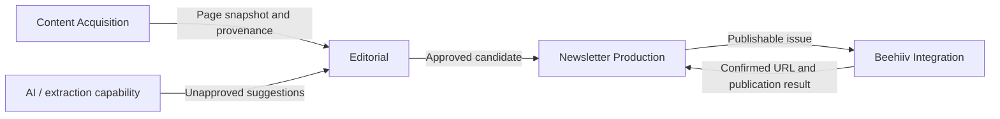

# Along the Lake: Domain Language and Context Map

## Purpose and evidence

This document is the canonical glossary and first context map for Along the
Lake. It records both the observed workflow and the proposed model; proposed
boundaries must not be mistaken for features already implemented.

The current-system notes and dashboard code confirm that crawled pages are
stored and displayed, crawl jobs can be monitored, records in `core.event` can
be managed, and AI summaries can be requested. The inspected crawler has no
Beehiiv publishing step. The operator's complete manual process between
crawled content and Beehiiv has not been verified. See
[Current System](./current-system.md) and
[Along the Lake project brief](./along-the-lake-ddd-project-brief.md).

## Business domain and subdomains

The business domain is local media and community information. Along the Lake
helps residents discover local events, businesses, places, and experiences in
Clarkson, Lorne Park, Port Credit, and Lakeview through a weekly newsletter.

| Subdomain | Purpose | Working classification |
|---|---|---|
| Local discovery and editorial curation | Decide what is relevant, trustworthy, and worth recommending | Core |
| Content acquisition | Fetch and preserve material from local sources | Supporting |
| Candidate extraction | Turn acquired material into structured possibilities for editorial review | Supporting capability within Editorial; not a separate context |
| Newsletter production | Assemble approved candidates into a coherent issue | Supporting for now; see open question |
| Beehiiv publishing | Deliver the finished issue through an external platform | Generic integration |
| AI assistance | Suggest extracted details or summaries without making editorial decisions | Generic/supporting capability |

The differentiating work is local discovery and editorial judgment, not
crawling or newsletter delivery.

## Bounded contexts

The contexts below are model boundaries, not deployment boundaries. Editorial
and Newsletter Production may remain modules in the same Next.js application.
The ownership descriptions are the target model; the current implementation
does not yet implement all of these models.

### Content Acquisition

**Purpose:** Retrieve source material and preserve what was observed.

**Owns:** source configuration, crawl runs, fetched pages and page snapshots,
fetch outcomes and failures, and content hashes.

**Excludes:** deciding whether material is locally relevant, creating or
approving editorial candidates, composing newsletter issues, and publishing
through Beehiiv.

**Answers:** What was fetched, from where, when, and with what result?

**Current evidence:** The crawler stores crawled content and crawl-job records.
Source configuration and a stable page-snapshot model are not established by
the inspected application.

### Editorial

**Purpose:** Decide what is worth including in Along the Lake and prepare
accurate, reviewable candidates.

**Owns:** editorial candidates, candidate type and details, category and
neighbourhood classification, provenance references, editorial decisions,
and duplicate decisions.

**Excludes:** fetching source pages, owning crawl-run outcomes, arranging
approved material into an issue, and sending or scheduling a newsletter.

**Answers:** Is this information suitable for Along the Lake, and what must be
corrected or decided before it can be used?

**Current evidence:** The application exposes crawled content and manages
records in `core.event`; the candidate review and approval lifecycle is
proposed, not confirmed as implemented. Existing event records must not be
silently treated as editorial candidates.

Candidate extraction and AI summarization are capabilities that support
Editorial. Their output is a suggestion for an editor, not an editorial
decision.

### Newsletter Production

**Purpose:** Turn approved editorial material into a specific, coherent
weekly issue.

**Owns:** newsletter issues, issue sections, issue items, ordering, issue
readiness, preview, and the issue content prepared for handoff.

**Excludes:** fetching source material, approving or rejecting candidates,
subscriber management, email delivery, and claiming external publication
before it is confirmed.

**Answers:** What exactly is in this issue, and is it ready for the publishing
handoff?

**Current evidence:** Issue composition and a production aggregate are
proposed; the inspected application does not establish a complete issue
workflow.

### Beehiiv Integration

**Purpose:** Hand a publishable issue to Beehiiv and record the external
publication outcome.

**Owns:** translation or export of an issue, Beehiiv-specific identifiers and
URLs, handoff details, and the recorded publication result.

**Excludes:** editorial decisions, issue composition, subscriber lifecycle,
and newsletter content ownership after handoff.

**Answers:** How was the finished issue delivered through Beehiiv, and what
external result can be verified?

**Current evidence:** The inspected API and worker have no Beehiiv endpoint or
publishing step. For Milestone 1, treat this as a manual adapter: prepare or
export the issue, transfer it in Beehiiv, then record the confirmed URL and
publication time. The operator's exact intermediate steps remain unknown.

## Context map

The arrows describe information handoffs, not automated integrations. In
particular, Beehiiv publication is manual for Milestone 1. Editorial remains
the authority for candidate decisions; Newsletter Production consumes only
approved candidates.

## Ubiquitous language

Use the precise term for the object and context. This glossary is canonical
for project documentation and should guide code, API, database, and Jira
naming where practical.

| Term | Definition | Context |
|---|---|---|
| Source | A website or feed monitored for potentially relevant local information | Content Acquisition |
| Crawl run | One attempt to retrieve content from one or more sources | Content Acquisition |
| Crawled page | The stable identity of a discovered web page, normally identified by its canonical URL | Content Acquisition |
| Page snapshot | Content retrieved from a crawled page at a particular time | Content Acquisition |
| Fetch outcome | The recorded result of attempting to retrieve a source or page | Content Acquisition |
| Candidate | A potential newsletter item awaiting an editorial decision | Editorial |
| Candidate extraction | Producing structured suggestions from acquired material for editorial review | Editorial capability |
| Provenance | Evidence linking a candidate to its source material, including a snapshot when available | Editorial |
| Local event | A time-bound occurrence that may be considered for publication | Editorial |
| Venue | A place or organization associated with an event or experience | Editorial |
| Organizer | A person, business, or organization responsible for an event | Editorial |
| Category | An editorial classification, such as Events, Food, or Hidden Gems | Editorial |
| Neighbourhood | The local area associated with content: Clarkson, Lorne Park, Port Credit, or Lakeview | Editorial |
| Editorial decision | Approval, rejection, or request for further review of a candidate | Editorial |
| Approved candidate | A candidate accepted by an editor and eligible for newsletter production | Editorial |
| Newsletter issue | The weekly publication being assembled | Newsletter Production |
| Issue section | A named grouping in an issue, such as Events, Food, or Hidden Gems | Newsletter Production |
| Issue item | The edited presentation of one approved candidate in one issue | Newsletter Production |
| Publishable issue | An issue prepared and approved for handoff to the publishing channel | Newsletter Production |
| Publication | A confirmed external release of an issue through Beehiiv | Beehiiv Integration |
| Preview | A rendering of issue content that has not itself been published | Newsletter Production |

### Terms to avoid without qualification

- Use `Local event` for a community occurrence; use `domain event` for a
  software-domain fact.
- Avoid `content` when `Page snapshot`, `Candidate`, or `Issue item` is more
  precise.
- Avoid `item` without specifying `Candidate` or `Issue item`.
- Qualify `status` as crawl-run, candidate, or issue status.
- Do not call a preview or export `published`. Reserve `Publication` for a
  confirmed external release.
- Use `Beehiiv` consistently (not `Beehiv`).

## Disagreements and open questions

These are deliberately visible rather than silently resolved. Update this
section when workflow evidence or an explicit product decision resolves them.

| Topic | What is known or disagrees | Question / next evidence |
|---|---|---|
| Core subdomain | The project brief classifies both Editorial and Newsletter Production as core; the earlier domain-language draft describes Editorial curation as core and production as supporting. This document treats editorial judgment as core and production as supporting for now. | Confirm whether issue composition itself provides differentiated value, or primarily enables editorial curation. |
| Existing `core.event` records | The application manages event records, while the target model introduces Editorial Candidates. Their lifecycle and data equivalence are not established. | Determine which records can become candidates and what migration or provenance is required; do not silently reinterpret existing rows. |
| Candidate extraction ownership | Extraction is listed as a supporting subdomain in one draft, but the context map has no separate extraction context. | Keep it as an Editorial-supporting capability unless independent ownership or lifecycle is demonstrated. |
| Local event vs. domain event | `Event` is used for local occurrences and can also mean a software-domain event. | Use `Local event` in business language and qualify software events in code and docs. |
| Publication state | The target model records publication, but current code does not establish an integrated or verified Beehiiv workflow. A preview is not a publication. | Confirm who records the Beehiiv URL/time and what evidence counts as a successful publication. |
| Manual Beehiiv workflow | The inspected crawler has no publishing integration; all steps after acquisition are not verified. | Walk through the operator's actual process, including editing, formatting, approval, scheduling, and confirmation. |
| Snapshot and source ownership | The current code stores crawled content and crawl jobs; it does not establish a stable snapshot model or source catalog. | Confirm the crawler's actual source and page identity behavior before implementing these as durable domain concepts. |

## Related documentation

- [Current System](./current-system.md) describes observed components and
  workflow, including unknowns.
- [Along the Lake project brief](./along-the-lake-ddd-project-brief.md)
  contains the delivery plan and tactical model; it should link here rather
  than maintain a competing glossary.
